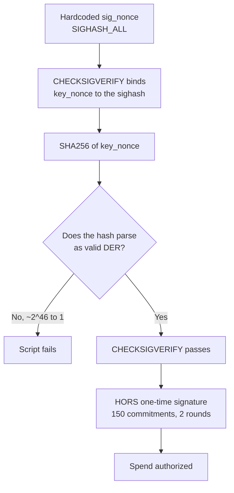

*August 26, 2026. Two independent post-quantum milestones happened within hours of each other. A complete coincidence. Or maybe not.*

---

The first is a [quantum-safe Bitcoin transaction](https://mempool.space/tx/305a24ffea912b9cf428f29ebf952321c96dab5bab284fc0d0801562f5abab07) that confirmed on mainnet, in block 964,199. No soft fork. No new opcodes. Built entirely out of Bitcoin Script rules that have existed since 2009.

The second is [BIP SHRINCS](https://github.com/SHRINCS/shrincs), the first concrete post-quantum signature scheme designed specifically for Bitcoin, published to the bitcoin-dev list the same afternoon.

One is an elegant use of the consensus rules Bitcoin already has. The other is a plan that still requires implementation.

## 🔓 What Quantum Actually Breaks

Pretty much every "quantum will steal your Bitcoin" article gets this wrong, so let's lay out the facts.

There are two quantum algorithms that matter, and they do things very differently.

**Shor's algorithm** solves the discrete logarithm problem efficiently. You give it an elliptic curve public key, and it hands you back the corresponding private key. This can completely break ECDSA and Schnorr.

**Grover's algorithm** speeds up searching, but only by a square root. Against a 160-bit hash it takes the work of finding a preimage from 2<sup>160</sup> down to roughly 2<sup>80</sup>, which is still far out of reach.

It also doesn't get much better by throwing more machines at it. Running 100 quantum computers on a Grover search gets you roughly a 10x speedup, not a 100x one. Classical mining is the opposite, which is why hash-based schemes hold up.

> Shor's breaks signatures. Grover's barely dents hashes. Every practical post-quantum Bitcoin design is built on top of that one difference.
{: .prompt-info }

Which leads to the conclusion that actually matters. Against a quantum attacker, **keeping your private key secret is not what protects your coins. Keeping your public key off the chain is.**

## 🎯 Which of Your Coins Are Actually at Risk

So the real question isn't "is Bitcoin quantum-safe." It's "is my public key on-chain right now."

| Output type | Public key exposed at rest? | Status |
|---|---|---|
| **P2PK** | Yes, the raw pubkey *is* the output | ⚠️ Exposed since 2009 |
| **P2PKH** (`1...`) | No, only HASH160 | ✅ Safe at rest |
| **P2SH** (`3...`) | No, only a script hash | ✅ Safe at rest |
| **P2WPKH** (`bc1q...`) | No, only HASH160 | ✅ Safe at rest |
| **P2WSH** (`bc1q...` long) | No, only SHA256 of the script | ✅ Safe at rest |
| **P2TR** (`bc1p...`) | **Yes**, the output *is* a 32-byte x-only pubkey | ⚠️ Exposed |

The P2PK row is the famous one. Roughly **1.72 million BTC**, about 9% of circulating supply, sits in pay-to-public-key outputs. Overwhelmingly coinbase rewards from 2009 and 2010, including the ~1.1M BTC generally attributed to Satoshi. Those public keys have been sitting in the clear for seventeen years.

The Taproot row is the one people get wrong.

### The Taproot trap

A Taproot output is not a commitment to a public key. It *is* a public key, the tweaked output key `Q`, sitting in the scriptPubKey as 32 bare bytes. Anyone who can solve for its discrete log can spend it via the key path.

The usual response is: "fine, I'll use a NUMS internal key and spend script-path only." A Nothing-Up-My-Sleeve point has no known discrete log, so nobody can key-path spend it.

That reasoning is correct, and it does not help you here.

> **A NUMS internal key does not make Taproot quantum-safe.** The tweaked output key `Q = P + tG` still *has* a discrete log, you just don't know it. Shor's algorithm computes it straight from the 32 bytes in the scriptPubKey, and the attacker key-path spends. Your tapleaves are never evaluated. NUMS defends against classical attackers only.
{: .prompt-warning }

Worth being precise about how little the attacker needs here. They don't need your script tree, your merkle root, or the internal key. They need the 32 bytes that are already sitting in the output. A NUMS point works classically because finding its discrete log would mean finding a collision between a hash function and point multiplication. A quantum computer doesn't need the collision. It hashes, gets the curve point, and runs Shor's on it.

This exact objection came up on the bitcoin-dev list in April 2026. Thomas Suau proposed that wallets could "already construct P2TR with a NUMS internal key to force script-path spending" and get post-quantum safety with no soft fork. conduition replied that "CRQCs can spend NUMS point addresses with the key-spend path, even if nobody else can." Suau conceded within a few hours: "So basically every P2TR is vulnerable, since script-path only enforcement relies on NUMS point? In that case P2TR is just quantum dead." conduition: "Exactly."

There's a nice piece of corroboration from the other direction, too. Pieter Wuille has proposed using a NUMS output as a **quantum tripwire**: a canary that nobody can spend classically, so a successful spend is itself proof that a cryptographically relevant quantum computer exists. That design only works *because* a NUMS point is expected to be spendable by a quantum attacker.

So "just put a hash-locked script in a tapleaf" isn't a quantum escape hatch. Taproot's design assumes key-path spending is always available to the rightful owner. Against Shor's, everyone is the rightful owner.

### And the hashed types are only safe until you touch them

The ✅ rows above come with a large asterisk. A hashed output hides your public key right up until you spend it, at which point the pubkey goes into the input script and lives in the chain's history permanently.

So "safe at rest" only applies to addresses you have **never spent from**. Any reused address is already exposed.

[Glassnode measured this in May 2026](https://research.glassnode.com/measuring-bitcoins-quantum-exposed-supply/) and put the total at **6.04M BTC, 30.2% of issued supply**, already carrying an exposed public key. They split it two ways:

| Category | BTC | Share of supply |
|---|---|---|
| **Structural** (P2PK, P2MS, P2TR: the script reveals the key by design) | 1.92M | 9.6% |
| **Operational** (address reuse, partial spends, custody behaviour) | 4.12M | 20.6% |

Look at those two rows again, because this is the part I did not expect.

> **Address reuse is roughly 70% of Bitcoin's quantum exposure.** Satoshi's P2PK coins get all the attention, but they are the minority of the problem. The bigger share is ordinary coins sitting in ordinary addresses that someone has already spent from at least once.
{: .prompt-warning }

Which makes the boring advice the important advice. Not reusing addresses has always been a privacy recommendation. It turns out to be the single biggest lever on quantum exposure too.

One caveat on the numbers. You will see "6.7M BTC, 34% of supply" quoted widely and attributed to Google's Quantum AI whitepaper. Google's paper actually says 6.9M and states no percentage at all, and the 6.7M figure is a December 2025 reading of Project Eleven's live tracker. The honest range across Glassnode, Google, and Project Eleven is 6.0M to 6.9M.

## 🧩 How You Spend Bitcoin Without ECDSA or Schnorr

Here's the fun part. [Avihu Levy](https://x.com/avihu28) at StarkWare, with Tomer Giladi taking it over the line, built a scheme called **QSB** that authorizes a Bitcoin spend using only hash preimage resistance. No elliptic curve assumption anywhere in the security argument. Under existing consensus rules.

It builds directly on Robin Linus's **BinoHash**, which used Bitcoin Script's `OP_CHECKMULTISIG` quirks to smuggle a hash-based one-time signature into legacy Script. BinoHash had one component that wasn't quantum-safe: its proof-of-work puzzle keyed on ECDSA signature *size*, which depended on forcing a minimum `r` value. Shor's can compute the discrete log of that `r` and collapse the puzzle entirely.

QSB replaces that one piece with what the paper calls a **hash-to-sig puzzle**, and it's quite elegant:

```
<sig_nonce>          // a DER signature, hardcoded in the locking script
OP_OVER
OP_CHECKSIGVERIFY    // verify sig_nonce against a spender-supplied key_nonce
OP_SHA256            // hash that pubkey
OP_SWAP
OP_CHECKSIGVERIFY    // now verify the HASH as if it were a signature
```

That's the actual pinning preamble from the mainnet transaction, five opcodes long.

Read the last line again. The script takes a 32-byte hash output and feeds it into `OP_CHECKSIGVERIFY` **as a signature**.

Here's why that works as a proof-of-work. Bitcoin signatures have to be written in a specific byte format called DER: the first byte has to be a particular tag, the length fields have to agree with each other, the two numbers inside have to be positive, and so on. A random string of bytes almost never satisfies all of that. The odds are roughly **1 in 2<sup>46</sup>**, or about 1 in 70 trillion.

So the only way to make that final check pass is to keep changing the transaction, re-hashing, and looking at the result, until one of them happens to come out looking like a valid signature. That searching is the work.



Because `sig_nonce` is hardcoded with `SIGHASH_ALL`, changing *any* field of the transaction changes the sighash, which changes the recovered `key_nonce`, which changes the hash, which breaks the DER check. The transaction is pinned. And the difficulty is fixed by the hash function itself. There's no knob to turn.

On top of the puzzle sits a HORS-style one-time hash signature: 150 commitments per round, two independent rounds, with the winning subset selected by which one produces valid DER. Combined, the paper claims **~118-bit second-preimage resistance under the Shor threat model**, meaning a quantum adversary with unlimited Shor's access gains *nothing*.

One thing worth being precise about, because it's easy to overstate. This transaction still contains real ECDSA signatures and still calls `OP_CHECKSIG`. It's legacy script, so there's no Schnorr in it anywhere. What changed is that none of the *security* rests on the curve. The signatures in the locking script are hardcoded and public, so there is no private key for Shor's to recover. The only thing an attacker has to break is finding a hash preimage.

The whole thing squeaks in under the limits Bitcoin already puts on legacy scripts. A script can run at most **201 operations** and be at most **10,000 bytes** long, and the mainnet script uses exactly that opcode budget and 9,923 of those bytes. It has to be a bare script rather than P2SH, because P2SH caps redeem scripts at 520 bytes. And it must be pre-SegWit, because it depends on `FindAndDelete`, a sighash quirk that SegWit removed.

## 💸 What It Actually Cost

This is my favorite part of the whole story.

| | |
|---|---|
| Locking script | **9,923 bytes** of bare script |
| Funding tx | 10,125 bytes → **30,000 sats** in fees |
| Spending tx | 1,403 bytes → **5,179 sats** in fees |
| Amount protected | **10,000 sats** |
| Off-chain GPU grinding | **~$75–150** |

Add it up: **35,179 sats of on-chain fees to move 10,000 sats.** They spent 3.5x what they actually moved, and that's before the GPU bill.

Which sounds absurd, and at 10,000 sats it is. But almost all of that cost is fixed. The script is the same size whether it's locking 10,000 sats or 10 BTC, and the grinding work doesn't change either. At 100 million sats, or a billion, paying ~35k sats in fees plus a GPU bill starts to look pretty reasonable.

The off-chain cost comes from three separate grinding phases (pinning the transaction, then finding a valid subset for each of the two digest rounds) at roughly 2<sup>46</sup> work apiece. It's embarrassingly parallel, so it's minutes of wall-clock on a rented fleet. The repo benchmarks an RTX PRO 6000 at 238 million candidates per second.

> The off-chain cost dominates the on-chain cost by roughly 100×. That inversion is the real reason this doesn't scale. Block space isn't the bottleneck, the grind is.
{: .prompt-info }

## 🔍 A Detail You Only See If You Read the Script

I pulled the raw 9,923-byte scriptPubKey and ran an opcode census on it. Two rounds of 150 HORS commitments, 8 signed selections in round one and 7 in round two. That matches the paper's recommended "Config A" geometry.

But the puzzle hash doesn't. The live script contains **three `OP_SHA256` and zero `OP_RIPEMD160`**, with the SHA-256 calls sitting in the pinning preamble *and* in both round puzzle paths. The paper's abstract, and every writeup quoting it, says RIPEMD-160.

This isn't a gotcha. The paper anticipates it. From the "SHA-256 Variant" section:

> SHA-256 has a slightly higher DER probability (∼2<sup>-45.4</sup> vs. ∼2<sup>-46.4</sup>), reducing off-chain work by roughly 2×, but the larger puzzle target slightly weakens the security analysis. […] For simplicity, we adopt RIPEMD-160 throughout.

So they took the variant that halves the grinding cost. Entirely reasonable when you're paying real money for GPU time to prove a point. It does mean the widely-quoted ~118-bit figure describes the paper's configuration rather than this specific transaction, by about a bit per round. Immaterial to the result, but worth knowing if you're citing the number.

## 📜 Why It Needed a Special Miner

The transaction is **consensus-valid but non-standard**. Those are different things: consensus rules decide what's allowed in a block, while standardness policy decides what nodes will relay to each other. A ~10KB bare script sails past the second one.

So it couldn't just be broadcast. [MARA Foundation](https://x.com/MARAFoundation_)'s Slipstream service, which accepts non-standard transactions by direct submission, mined it.

That's a real limitation, not a footnote. A quantum-safe scheme you can only use by asking a specific miner nicely is not a scheme most people can use.

## 🔮 SHRINCS: The Path That Actually Scales

Which brings us to the other thing that happened today.

**SHRINCS**, Shrunken SPHINCS, is a hash-based post-quantum signature scheme from conduition, [Ethan Heilman](https://x.com/Ethan_Heilman), Mikhail Kudinov, Oleksandr Kurbatov, [Jonas Nick](https://x.com/n1ckler), and remix7531. It's the first concrete PQ signature proposal written specifically for Bitcoin's constraints.

The design choice I find most interesting is what it *refuses* to assume. SHRINCS is instantiated purely with SHA-256. No lattices, no new hardness assumptions beyond the hash function Bitcoin already depends on. The reasoning is explicitly about time horizons: Bitcoin outputs sit unspent for decades, so conservative assumptions are worth paying for.

It combines two components. A **stateful** path, a flexible XMSS tree of WOTS+C one-time signatures, gives you small signatures if you carefully track which leaves you've used. A **stateless** SLH-DSA fallback covers you when that state is lost or reset, at the cost of a bigger signature.

| Item | Size |
|---|---|
| Public key | **48 bytes** |
| Stateful signature | 548 – 4,619 bytes |
| Stateless signature | 5,777 bytes |

That minimum combined size is **13.2× smaller** than SLH-DSA-SHA2-128s and **6.3× smaller** than the lattice-based ML-DSA-44. It targets NIST category 1: 128-bit classical, 64-bit quantum security.

And it is very much not finished. It's a draft with no BIP number yet, and the security proof is marked TODO.

It also needs two BIPs, not one. This draft specs only the cryptography, the key generation, signing and verification algorithms. Putting SHRINCS into Bitcoin Script so you can actually lock coins with it takes a second BIP on top of this one. Then a soft fork to activate it. Wallet UX around backing up and recovering signing state is, in Jonas's words, "at an early stage."

## ⚖️ Two Very Different Answers

| | QSB | SHRINCS |
|---|---|---|
| Works today | ✅ Proven on mainnet | ❌ Draft spec |
| Needs a soft fork | No | Yes, after a second BIP specs the Script side |
| Cost per spend | ~$75–150 + fees | Normal fees |
| On-chain size | ~10 KB | 548 bytes + 48-byte key |
| Reusable key | No, one-time | Yes |
| Relayable | No, needs a friendly miner | Yes, post-fork |

QSB proves the thing is *possible* under rules that already exist. SHRINCS is what you'd actually deploy. Neither is a substitute for the other, and today is the first day both exist.

## ⚡ So What About DLCs?

Shor's algorithm solves the discrete logarithm problem. Discreet Log Contracts have it in the name. I build on these for a living, so I went looking for the answer, and as far as I can tell nobody has written it down.

I mean that literally. Searching the [dlcspecs repo](https://github.com/discreetlogcontracts/dlcspecs) for "quantum" returns zero results. Zero code hits, zero issues, zero pull requests. Same for bitcoin-dev going back to 2018, same for Delving Bitcoin, same for [Tadge Dryja's original DLC paper](https://adiabat.github.io/dlc.pdf) from 2017. Dryja, incidentally, also co-wrote the Lightning Network paper with Joseph Poon, so this is the second protocol of his that inherits this problem.

So here's my attempt. There are three things a quantum attacker could go after, and I had them ranked wrong before I looked properly.

### 1. Forging the oracle

A DLC oracle publishes a public key `P` and a one-time nonce `R` ahead of an event, then later reveals an attestation `s`. All of `P` and `R` are on the internet in advance, in the clear. Run Shor's on them and you recover the oracle's private key, and then you can sign whatever outcome you like.

Worse, the oracle's public key is **reused across every event by design**. One Shor's run doesn't compromise one contract. It compromises every contract that oracle has ever served and every one it ever will.

And "just use more oracles" does not help here at all. Multi-oracle DLCs aggregate by adding the points together, so a quantum attacker runs Shor's once on the sum. Using five oracles multiplies the cost of *bribing* them by five and the cost of *breaking* them by one.

But notice what a forged attestation actually buys you. The payout addresses in every CET are fixed when the contract is set up. A forged attestation only decides **which pre-signed transaction becomes executable**, and the adaptor signatures needed to execute it are held only by the two counterparties. A stranger with a forged attestation gets nothing.

### 2. Decrypting the adaptor signature

This was my first worry and it turns out to be the same attack as the one above.

In a general scriptless script, an adaptor signature is encrypted under some point `T = tG` and you'd have to solve for `t`. But in a DLC, that point isn't arbitrary. It's the **anticipation point**, computed from the oracle's own published values:

```
S = R + H(R || P || m) * P
```

The parties compute `S` before the attestation exists, from public data. Which means the secret hiding behind it *is* the oracle's attestation scalar. Recovering the adaptor secret and forging the oracle's signature are the same computation on the same point.

> **Adaptor signatures add no quantum attack surface to a DLC.** The thing you'd be solving for is the oracle attestation you could already forge by breaking the oracle directly. It's not a second weakness, it's the same one wearing a different hat.
{: .prompt-info }

So my instinct that this one is survivable was right, and right for roughly the reason I thought: the money still goes to addresses agreed up front. But it was also the wrong thing to be worried about.

### 3. Just taking the money

This is the one that actually binds, and it's much more boring than the other two.

A DLC funding output is a P2WSH 2-of-2 multisig. On chain, that's a hash. Nothing is revealed until it's spent. That's exactly why we use it instead of a Taproot output, and against someone watching the blockchain it works.

The problem is that the blockchain is not the only place your public key exists.

The DLC protocol puts `funding_pubkey` directly in the `offer_dlc` and `accept_dlc` messages. Your counterparty is handed your raw funding public key when you negotiate the contract, long before anything is broadcast. A quantum-capable counterparty never needs to look at the chain at all. They run Shor's on the key you sent them, sign both halves of the 2-of-2 themselves, and spend the whole funding output anywhere they want.

> **A correction to something I said earlier in this post.** I wrote that a P2WSH DLC output is a hash of the script, "so nothing is exposed until the contract actually settles." That's true against a chain observer and false against your counterparty. The P2WSH-over-Taproot choice still does real work, but it defends against the wrong adversary to call it a solution.
{: .prompt-warning }

It's worse than a one-time risk, too. Anyone who ever logged those offer and accept messages holds those public keys forever. A relay, an app server, a database backup, a breach. Harvest now, decrypt later applies to DLC negotiation just as much as it applies to encrypted traffic.

None of this is DLC-specific. It's the same argument people made about Lightning earlier this year, and DLCs inherit the structure deliberately: dlcspecs orders the funding pubkeys per BIP67 specifically so the output looks like a Lightning funding output.

One place DLCs come out genuinely ahead: modern CETs pay straight to the payout address with no revocation script, so there's no force-close delay window for an attacker to race you in. Dryja's original 2017 construction did have timelocked punishment branches and would have had that window. Moving to adaptor signatures removed it.

### Can you just move the funds?

My first thought was that this is all manageable, because if quantum started looking real you'd move the collateral into a fresh 2-of-2 or a 2-of-3 before it mattered.

Having actually thought it through: no, not really.

**Multisig provides no quantum security.** Two keys is two Shor's runs. Three keys is three. Threshold signing defends against one key being stolen, not against a machine that derives private keys from public ones. Migrating from a 2-of-2 to a 2-of-3 accomplishes nothing except costing you a transaction fee.

**It requires a cooperative counterparty.** It's a 2-of-2. The counterparty who owns the quantum computer simply declines to co-sign and waits you out. Your only unilateral exit is the timelocked refund, which spends the same output with the same keys.

**And right now there's nowhere quantum-safe to go.** That's the whole point of the first two thirds of this post. SHRINCS is a draft with a TODO security proof that needs a second BIP and a soft fork. QSB works today and costs $75–150 of GPU time per spend and a friendly miner. Neither is somewhere you park loan collateral.

Migration buys time. It is not a way to become quantum-safe.

### The part that actually worries me

Post-quantum adaptor signatures do exist. They come from lattices, isogenies, and group actions: [LAS](https://eprint.iacr.org/2020/845), [IAS](https://eprint.iacr.org/2020/1345), [GATOR](https://eprint.iacr.org/2026/1067). They work, and they're enormous. A DLC adaptor signature today is 162 bytes. GATOR's pre-signature is around 25 KB. That's roughly 150x, per outcome.

But size isn't the real problem. This is:

> **Nobody knows how to build an adaptor signature out of a hash function.** Not from SPHINCS+, not from WOTS+, not from FORS, not from XMSS. Every post-quantum adaptor signature that exists comes from an algebraic assumption, because adaptor signatures need the signature scheme to have homomorphic structure, and hash-based schemes don't have any.
{: .prompt-danger }

Now look at where Bitcoin is actually heading. SHRINCS is hash-based on purpose, SHA-256 only, no lattices, and the stated reason is that Bitcoin outputs sit unspent for decades so conservative assumptions are worth paying for. That's the Bitcoin-culture-compatible choice and I think it's the right one.

Which leaves an awkward conclusion. The post-quantum direction Bitcoin is most likely to take is the one direction on which DLCs, as currently built, do not work.

I want to be careful not to overstate this. There's a [2021 impossibility result](https://eprint.iacr.org/2021/150) proving you can't build adaptor signatures from signature schemes with unique signatures, which covers deterministic hash-based constructions but not randomized ones. So it isn't proven impossible. The honest version is that no construction exists, no impossibility proof exists, and as far as I can tell nobody is working on it. There's [one lattice-based paper](https://www.sciencedirect.com/science/article/abs/pii/S2214212625002856) from late 2025 attacking the underlying problem, and that's about the whole field.

That feels like a gap worth someone filling.

## What I Think This Means

Avihu is careful to say this is a research curiosity rather than the sensible road to a post-quantum Bitcoin, and he's right. Nobody is going to pay $150 of GPU time per spend.

But existence proofs change conversations. "Bitcoin can't do post-quantum without a fork" was a defensible claim yesterday and is a false one today, at any price. The argument moves from *whether* to *what it costs*, and cost arguments get won by engineering.

The part that sticks with me is the time horizon underneath all of this. "Your coins are safe until you spend them" sounds like a complete answer, and it is one if your Bitcoin moves every week.

We build [Bitcoin-collateralized loans at Lygos](https://lygos.finance), where you lock collateral up for years and borrow against it. Over that kind of horizon the safety of that Bitcoin is paramount, and "safe until you spend" is a much weaker promise than it sounds.

That's one of the reasons we use P2WSH 2-of-2 multisig DLCs rather than Taproot DLCs today. A Taproot output puts a public key on chain the moment the contract is funded, and it sits there for the whole life of the loan. A P2WSH output is a hash of the script, so nothing is on chain until the contract settles.

That's a real advantage against anyone reading the blockchain, and as the DLC section above works through, it is not the whole story. Your counterparty already has your funding public key. Choosing P2WSH shortens how long that key is exposed to the world. It does nothing about who you handed it to.

Only time will tell whether quantum computers ever get the power people are afraid of, or whether they end up being the boogeyman. Either way, today was the day Bitcoin stopped waiting to find out.

---

**Sources**

- The transaction: [`305a24ff…ab07`](https://mempool.space/tx/305a24ffea912b9cf428f29ebf952321c96dab5bab284fc0d0801562f5abab07) on mempool.space
- [QSB repo](https://github.com/avihu28/Quantum-Safe-Bitcoin-Transactions) : Quantum-Safe Bitcoin Transactions Without Softforks
- [Draft BIP SHRINCS](https://github.com/SHRINCS/shrincs)
- [Glassnode: Measuring Bitcoin's Quantum-Exposed Supply](https://research.glassnode.com/measuring-bitcoins-quantum-exposed-supply/), May 2026 : the 6.04M / 30.2% figure and the structural vs operational split
- [Google Quantum AI: Securing Elliptic Curve Cryptocurrencies against Quantum Vulnerabilities](https://arxiv.org/pdf/2603.28846), March 2026 : the 1.7M P2PK figure
- [Project Eleven: Bitcoin Risq List](https://bitcoin-risq-list.projecteleven.com) : live exposed-supply tracker
- [Chaincode Labs: Bitcoin and Quantum Computing](https://chaincode.com/bitcoin-post-quantum.pdf), May 2025
- [Tadge Dryja: Discreet Log Contracts](https://adiabat.github.io/dlc.pdf), 2017
- [dlcspecs](https://github.com/discreetlogcontracts/dlcspecs) : the DLC protocol specification, including the oracle and funding transaction details
- [Two-Party Adaptor Signatures From Identification Schemes](https://eprint.iacr.org/2021/150), PKC 2021 : the impossibility result for unique-signature schemes
- Nadav Kohen's DLC and scriptless script series, which I mirror [here]() after Suredbits shut down
